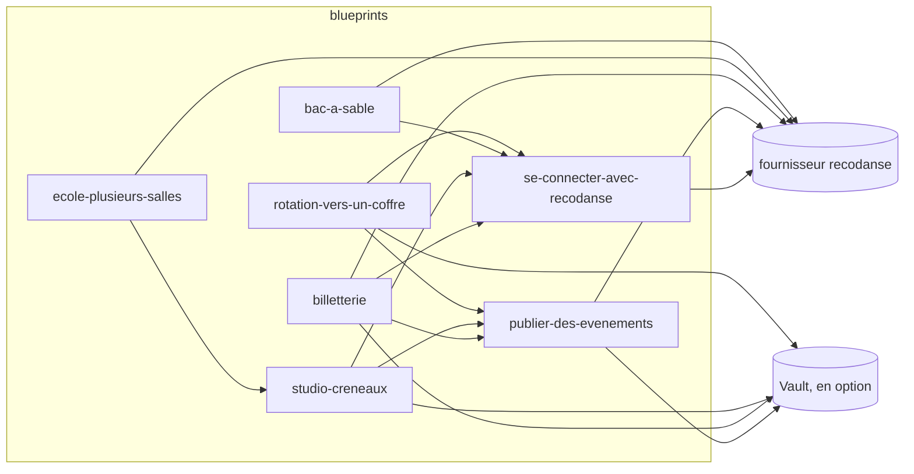

**Blueprints ReCoDanse**

# Les blueprints ReCoDanse

Des modules prêts à appeler pour brancher un logiciel sur **ReCoDanse** sans
passer par l'écran « Mes applications » : chacun décrit **un scénario** — ce que
le tiers veut faire — avec le minimum de portées qu'il exige, ses webhooks, et le
chemin de ses secrets. Ils reposent sur le fournisseur
`arcodange-org/recodanse` (dépôt `arcodange-org/terraform-provider-recodanse`).

> **Source** : `github.com/arcodange-org/recodanse-blueprints`, miroir de la forge d'Arcodange.
> Licence MPL-2.0. La démo qui les appelle : `arcodange-org/recodanse-iac-demo`. Les modules s'appellent par leur **tag git** : le
> registre public des modules exige un dépôt par module (`terraform-recodanse-<nom>`), pas ce dépôt.

## Les scénarios

| Scénario | Module | Ressources | Portées demandées | Pour qui |
|---|---|---|---|---|
| « Se connecter avec ReCoDanse » | [`se-connecter-avec-recodanse`](modules/se-connecter-avec-recodanse/README.md) | `recodanse_application` (`connexion`) ; `recodanse_webhook` (`autorisation.retiree`, `compte.efface`) si une portée l'exige | `openid` (défaut) ; `profile`, `email`, `offline_access`, `videos.lire` exigent le webhook (la revue l'impose) | tout site qui veut connaître ses danseurs ; socle des autres modules |
| Publier des événements | [`publier-des-evenements`](modules/publier-des-evenements/README.md) | `recodanse_application` (`service`) ; `time_rotating` ; `vault_kv_secret_v2` en option | `evenements.publier` (ou `creneaux.publier`) | un agenda, un festival, une billetterie |
| Billetterie | [`billetterie`](modules/billetterie/README.md) | service + `recodanse_webhook` `publication.retiree` ; connexion en option | `evenements.publier` ; `openid` | une billetterie |
| École à plusieurs salles | [`ecole-plusieurs-salles`](modules/ecole-plusieurs-salles/README.md) | **une** application de service pour toutes les salles ; webhook `publication.retiree` en option | `creneaux.publier` | une école à plusieurs lieux |
| Studio — créneaux | [`studio-creneaux`](modules/studio-creneaux/README.md) | service ; connexion des élèves en option | `creneaux.publier` (+ `evenements.publier`) — ⚠ **créneaux SUSPENDUS (DAC7)** : rangés, pas montrés | un studio et ses cours réguliers |
| Bac à sable | [`bac-a-sable`](modules/bac-a-sable/README.md) | application d'essai ; source `recodanse_comptes_fictifs` ; `recodanse_evenement_du_bac_a_sable` (`compte.efface`) | `openid`, `profile` | prouver son webhook d'effacement avant la revue |
| Rotation vers un coffre | [`rotation-vers-un-coffre`](modules/rotation-vers-un-coffre/README.md) | `time_rotating` commun ; connexion et/ou service ; `vault_kv_secret_v2` derrière `coffre` | celles des applications | tout tiers qui range ses secrets dans Vault |

Chaque module a un **exemple** appelant dans [`exemples/<scénario>/`](exemples/).



## Les règles que tous suivent

- **Le minimum.** Chaque module demande la plus petite portée qui fait le
  scénario ; toute portée de plus est une entrée explicite, vérifiée au plan
  contre le catalogue (`data.recodanse_catalogue` l'annonce).
- **Des entrées vérifiées.** Chaque variable a sa `validation` (nom, adresses
  `https://` vers un hôte public, portées, chemins de coffre) ; ce qui croise deux
  variables est une `precondition` (une portée gardée sans webhook, soumettre sans
  conditions acceptées, une rotation sur un client public).
- **Un secret ne sort que `sensitive`.** `client_secret`, les clés `whsec_…` ne
  sortent que par des sorties sensibles — ou vers Vault, dans le même `apply` que
  leur rotation. L'état les contient : il se range **chiffré** (voir la démo).
- **Rien n'est accepté à ta place.** `accepte_les_conditions` s'écrit de ta main ;
  le fournisseur refuse au plan une version périmée.

## Appeler un module

```hcl
module "billetterie" {
  source = "git::https://github.com/arcodange-org/recodanse-blueprints.git//modules/billetterie?ref=v0.1.0"

  nom         = "Billets du Quai"
  webhook_url = "https://billets-du-quai.example/webhooks/recodanse"
}
```

## Installer le fournisseur

Publié, le fournisseur vient du registre (`arcodange-org/recodanse`) : `tofu init` suffit.
Pour essayer une branche du fournisseur, ou avant sa publication, `scripts/construire-le-miroir.sh` le
construit depuis ton clone de son dépôt (`FOURNISSEUR_SRC` : son chemin ; `FOURNISSEUR_VERSION` :
la version à annoncer) dans un **miroir local**
(`.outils/miroir`, ignoré par git) et écrit une configuration du CLI **propre au
dépôt** (`.outils/tofurc`, depuis [`outils/tofurc.modele`](outils/tofurc.modele)) :
`filesystem_mirror` pour `arcodange-org/recodanse`, le registre
d'OpenTofu pour `hashicorp/time` et `hashicorp/vault`. `~/.terraformrc` et
`~/.terraform.d` ne sont **jamais** touchés.

```bash
export FOURNISSEUR_SRC=/chemin/vers/terraform-provider-recodanse
scripts/construire-le-miroir.sh
export TF_CLI_CONFIG_FILE="$PWD/.outils/tofurc"
cd modules/billetterie && tofu init -backend=false && tofu test
```

## Les essais

```bash
scripts/tester.sh                    # miroir, fmt -check, aucune-cuisine, puis init/validate/test de chaque module et init/validate de chaque exemple
scripts/tester.sh --sans-construire  # sans reconstruire le fournisseur
make tester                          # la même chose
```

Codes : **0** vert ; **1** une étape rouge (le tableau final la nomme, le journal
complet est dans `.outils/journaux/`) ; **2** rien n'a été mesuré (outil absent,
fournisseur introuvable) — jamais un verdict du code. Un `tofu test` qui rend 0
sans avoir joué un seul run est compté **rouge** (témoin d'instrument).

`tofu test` joue chaque module avec des fournisseurs **simulés**
(`mock_provider "recodanse"`, `"time"`, `"vault"` — OpenTofu ≥ 1.8) : aucun jeton,
aucun appel. Chaque module a des runs qui passent et des runs `expect_failures`
sur ses validations et préconditions. Ce qui est éprouvé est le **module** ; le
fournisseur a ses propres essais, dont un à vrais binaires contre un Hydra réel.

`scripts/aucune-cuisine.sh` garde la documentation publique : il balaie les
fichiers suivis (hors `.gitea/`) et rougit sur un renvoi à l'organisation interne
du projet (numéros de tickets, de lots ou de règles internes, hôtes privés). Codes :
0 propre, 1 la liste des lignes, 2 rien n'a été lu.

Deux CI rejouent `scripts/tester.sh` : celle de GitHub
([`.github/workflows/ci.yml`](.github/workflows/ci.yml)) et celle de la forge
d'origine ([`.gitea/workflows/ci.yml`](.gitea/workflows/ci.yml)). `scripts/lint-workflows.sh`
passe la seconde à `actionlint` (code 0 ; un seul message ignoré, nommé : `upload-artifact@v3`,
imposé par Gitea Actions).

### Les essais mordent (OpenTofu 1.10.5, fournisseur 0.2.0)

Relevés dans l'ordre **intact → sabotages → rétabli**, chaque sabotage **vérifié
appliqué** (grep) avant lecture :

| Relevé | Code | Ce qui rougit |
|---|---|---|
| intact (`scripts/tester.sh`, 36 étapes) | 0 | — |
| la `validation` de `rotation_jours` retirée (`publier-des-evenements`) | 1 | `une_rotation_au_dela_d_un_an_est_refusee` |
| la précondition « portée gardée ⇒ webhook » rendue toujours vraie (`se-connecter-avec-recodanse`) | 1 | `profile_sans_webhook_est_refuse` |
| rétabli (36 étapes) | 0 | — |

Un sabotage écrit `condition = true` est **refusé par `tofu init`** (« la
condition doit se référer à un objet ») : il ne mesure rien des essais. Le second
sabotage utilise donc une condition toujours vraie qui se réfère au module.

## Limites connues

- Les modules sont éprouvés par `tofu test` avec des fournisseurs **simulés** ; ils
  ne sont pas encore joués de bout en bout contre un environnement ReCoDanse réel.
- `bac-a-sable` : le bac à sable n'est pas encore ouvert, ses routes
  `/v1/bac-a-sable/*` sont un contrat supposé.
- `publication.retiree` ne se déclenche que par la modération de ReCoDanse : le bac
  à sable ne sait pas encore l'envoyer.
